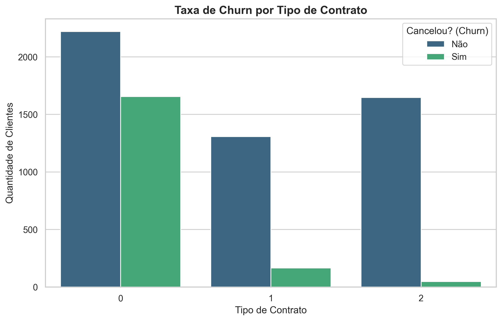
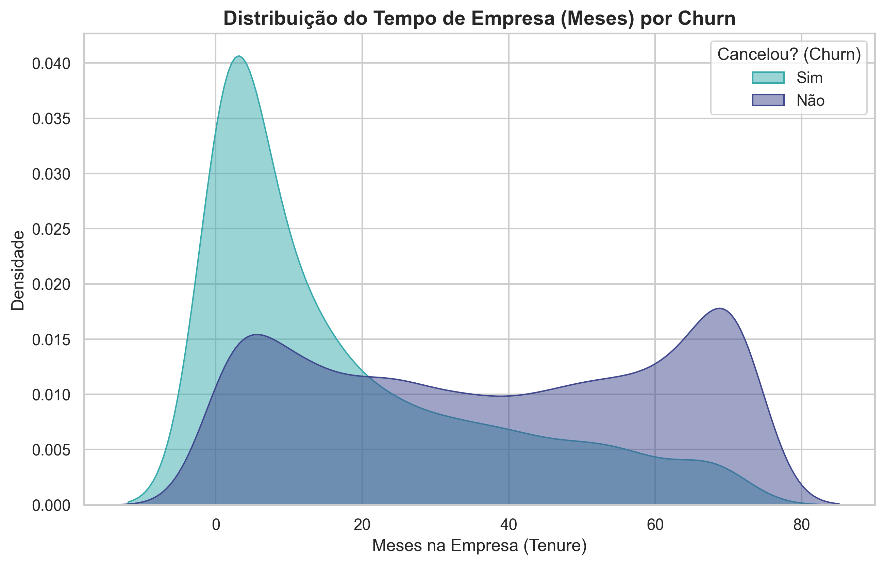

# 📉 Previsão de Churn em Telecomunicações com Machine Learning

## 1. O Problema de Negócio
Reter clientes atuais é drasticamente mais barato do que adquirir novos. Neste projeto, o objetivo foi construir um modelo preditivo para identificar clientes de uma empresa de telecomunicações que apresentam alto risco de cancelar seus serviços (Churn). Com essa previsão, o time de marketing e retenção pode agir preventivamente oferecendo incentivos personalizados, evitando a perda de receita recorrente.

## 2. Análise Exploratória e Insights Clave
Durante o desenvolvimento, identificou-se que a base de dados apresentava um forte desbalanceamento: cerca de 73.5% dos clientes eram da classe "Não Churn" contra 26.5% da classe "Churn".

Ao analisar as características dos clientes, dois insights de negócio principais foram encontrados:

* **O tipo de contrato é decisivo:** Clientes com contrato mês a mês (Month-to-month) possuem uma taxa de cancelamento massivamente maior do que clientes com contratos anuais ou bianuais. Incentivar a migração para planos de longo prazo é uma estratégia direta de retenção.

* **O risco é maior no início:** A maior densidade de cancelamentos ocorre nos primeiros meses de relacionamento do cliente com a empresa (Tenure entre 0 e 12 meses). Estratégias de onboarding e suporte dedicado no início da jornada são fundamentais.

## 3. Abordagem Prática e Evolução dos Modelos
Como a base de dados é altamente desbalanceada, os algoritmos tradicionais tendem a focar na classe majoritária (clientes que ficam). Para resolver isso e priorizar o negócio, adotei uma abordagem de melhoria contínua em 4 etapas focando estritamente em aumentar o **Recall da Classe 1 (Churn)**.

Abaixo está a tabela comparativa dos resultados reais obtidos na base de teste (1.409 clientes):

| Experimento | Algoritmo / Técnica | Acurácia Geral | Precisão (Churn) | Recall (Churn) | F1-Score (Churn) |
| :--- | :--- | :---: | :---: | :---: | :---: |
| **Mapeamento Inicial** | Random Forest (Padrão) | 80% | 66% | 47% | 55% |
| **Experimento 1** | Random Forest + SMOTE | 78% | 58% | 58% | 58% |
| **Experimento 2** | XGBoost Balanceado | 76% | 54% | 67% | 60% |
| **Experimento 3 (Vencedor)** | **XGBoost + Ajuste de Limiar (0.35)** | **74%** | **51%** | **78%** | **62%** |

### 🧠 Análise Crítica do Resultado de Negócio
* **Por que o Experimento 3 é o melhor para a empresa?** No modelo inicial, a empresa perdia **53%** dos clientes que iam cancelar sem receber nenhum aviso prévio (Recall de 47%). No modelo final, ao reduzir o limiar de decisão para `0.35`, o modelo tornou-se muito mais sensível: agora detectamos **78%** dos cancelamentos reais antes que eles aconteçam.
* **O Trade-off:** Para salvar mais clientes, aceitamos uma queda controlada na precisão (51%). Isso significa que o time de marketing fará algumas ofertas para clientes que talvez não fossem cancelar imediatamente, mas o custo desse "alarme falso" (como um cupom ou pequeno desconto) é drasticamente menor do que o custo total de perder um contrato recorrente para a concorrência.

## 4. O que eu aprendi neste projeto (Conclusões Técnicas)
* **Tratamento de Missing Values:** Identificação e imputação de valores nulos ocultos (espaços em branco convertidos para `NaN`) usando a mediana dos dados de treino para evitar falhas matemáticas em algoritmos sensíveis.
* **Lidar com Dados Desbalanceados:** Aplicação prática de técnicas de oversampling sintético (SMOTE) e manipulação do parâmetro de peso interno (`scale_pos_weight`) no XGBoost.
* **Métricas Alinhadas ao Negócio:** Entendimento prático de que a Acurácia pode ser uma métrica ilusória em dados desbalanceados, e que a escolha final entre Precisão e Recall deve ser guiada pelo impacto financeiro do problema.
* **Otimização por Threshold:** Calibração manual do limiar de probabilidade para ajustar a sensibilidade do algoritmo ao cenário ideal do negócio.
